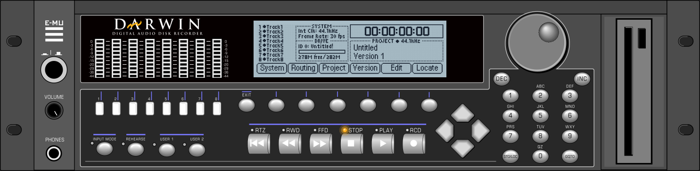

# E-mu Darwin emulator

An emulator of the **E-mu Darwin**, the 8-track digital audio disk recorder of 1997. It runs the
machine's original firmware, on Windows, Linux and macOS.



> This project is independent. It is not affiliated with, endorsed by or connected to E-mu
> Systems, or to Creative Technology Ltd, which owns the E-mu brand. E-mu, Darwin and the E-mu
> logo are trademarks of their owners and are used here only to name the hardware being
> emulated. **No firmware is included:** use the ROM images of your own unit.

## Download

Get the package for your system from [Releases](../../releases): Windows (`windows-x64.zip`),
Linux (`linux-x64.tar.gz`, needs SDL2 and ALSA) or macOS 11+ (`macos-universal.zip`, Apple
Silicon and Intel; it is not notarized, so first run `xattr -dr com.apple.quarantine .` in the
unpacked folder).

Unpack it somewhere you can write to: the emulator keeps its settings in its own folder.

## First steps

1. Put your firmware zip (`emu_darwin_v2_50.zip` or `emu_darwin_v2_02.zip`) in the `Firmware`
   folder, and start the program.
2. Click the **E-MU logo** on the panel: it opens the settings (audio and MIDI devices, disks,
   firmware version, keyboard keys).
3. On the **Disks** page, press **New...** for SCSI ID 0 to make a disk image, then OK.
4. Format the disk on the Darwin (System, then Disk) and create a project.

From there it works like the real unit: follow E-mu's original **Darwin owner's manual**, which
is available online (archive.org has copies).

## Building

Fetch Nuklear (a git submodule) with the source:

```bash
git clone --recurse-submodules <this repository's URL>
```

| System | Needs | Build |
|---|---|---|
| Windows | [MSYS2](https://www.msys2.org): `pacman -S make mingw-w64-ucrt-x86_64-gcc mingw-w64-ucrt-x86_64-SDL2` | `make -C darwin` in the UCRT64 shell |
| Linux | gcc, make, pkg-config, `libsdl2-dev`, `libasound2-dev` | `make -C darwin` |
| macOS | Xcode command line tools, `brew install sdl2` | `make -C darwin` |

Pushing a version tag (`scripts/release.sh 1.1 --push`) makes GitHub Actions build all three and
publish a release.

## Pricing

This tool is provided to everyone for free, however if you would like to say thanks or help support continued development of this and projects to come, feel free to send a coffee:

[](https://www.buymeacoffee.com/covert.skunkworks)


## Licence

This project is released under the GPLv3.
Built in:
 - [Musashi](https://github.com/kstenerud/Musashi) (MIT) with SoftFloat (John R. Hauser),
 - [SDL2](https://www.libsdl.org) (zlib),
 - [Nuklear](https://github.com/Immediate-Mode-UI/Nuklear) (public domain / MIT),
 - the Droid Sans font (Apache 2.0).

